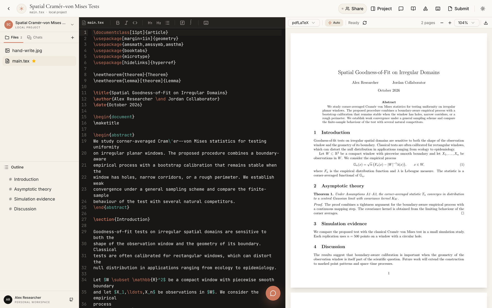
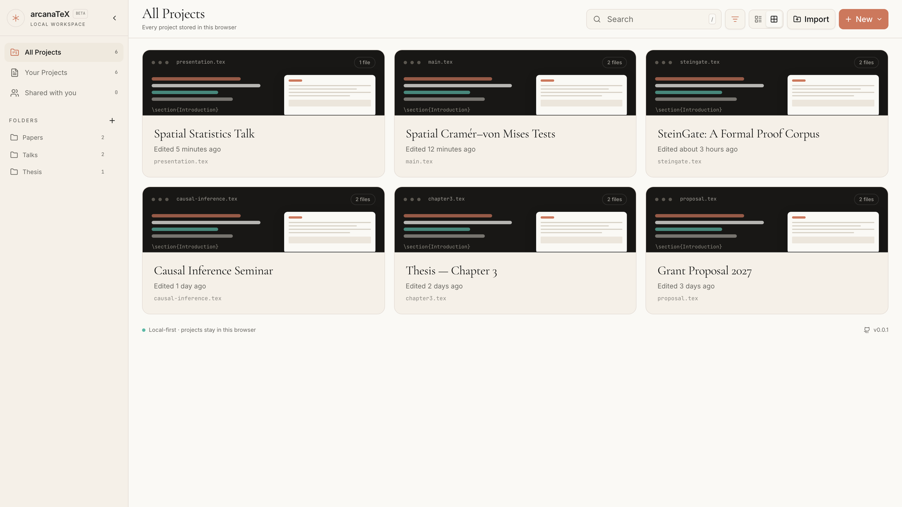
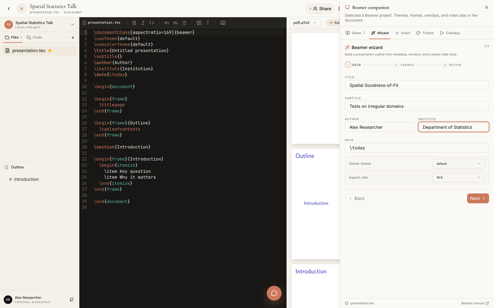
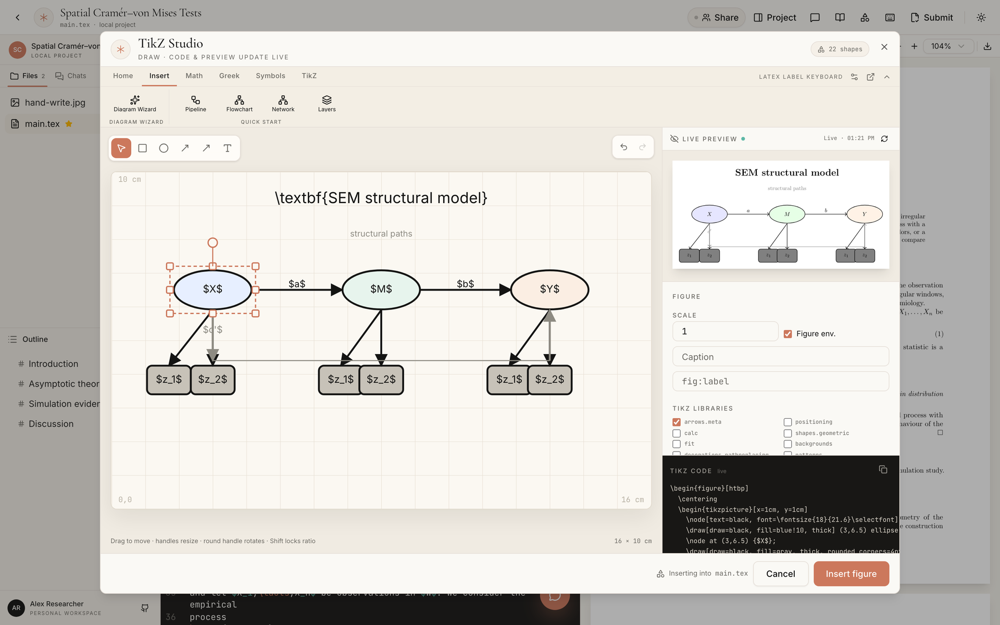
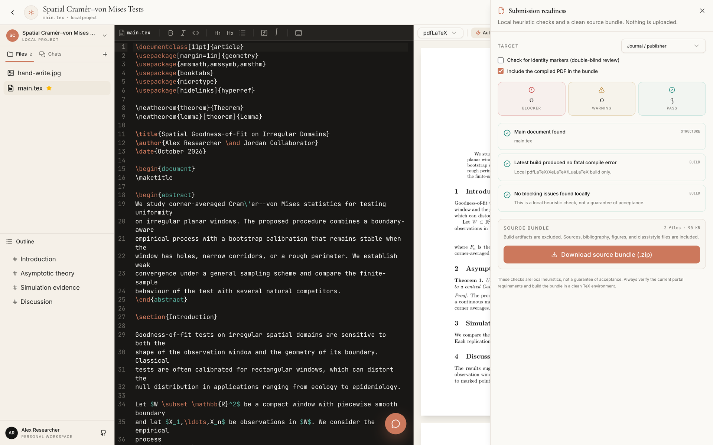

# arcanaTeX

**A local-first AI LaTeX and Lean workspace for the whole research handoff.**

arcanaTeX pairs a multi-file LaTeX editor and live PDF preview with AI
assistance, structured paper review, Lean 4 analysis, presentation tools,
publication-ready diagrams, and submission packaging. Projects stay in your
browser by default; compilation and optional model calls go through services
you configure.

<p align="center">
  
</p>

<p align="center">
  <sub>Write LaTeX, compile continuously, review the PDF, and keep diagnostics and research tools beside the source.</sub>
</p>

## Screenshots

| Project library | Beamer wizard |
| :---: | :---: |
| [](./assets/screenshots/project-library.png) | [](./assets/screenshots/beamer-wizard.png) |
| **TikZ studio** | **Submission readiness** |
| [](./assets/screenshots/tikz-studio.png) | [](./assets/screenshots/submission-readiness.png) |

## What you can do

- **Write** in a complete multi-file LaTeX project with syntax highlighting,
  autosave, a file tree, an outline, and a live PDF beside the editor.
- **Check** every build through structured diagnostics. Jump to the source
  line, inspect a suggested diff, and apply conservative deterministic fixes.
- **Review** a manuscript with the `/paper-review` skill: a structured,
  read-only editorial panel with methodology, domain, and devil's-advocate
  challenges plus a revision roadmap.
- **Formalize** with Lean 4 awareness: `.lean` files are syntax-highlighted,
  included in chat context, and summarized for declarations, axioms, and
  incomplete proofs.
- **Preview** Markdown notes and review reports with GFM, math, tables, and
  code rendering side by side with the source.
- **Present** with a contextual Beamer companion: frame navigator, themes,
  overlays, speaker notes, handouts, and a guided deck wizard.
- **Draw** publication-ready TikZ figures with a snap-grid studio, live
  compiled preview, multi-selection, grouping, and 28 research/statistics
  templates.
- **Submit** with target-aware preflight checks and a clean source bundle built
  entirely in the browser.
- **Collaborate** through a self-hosted WebSocket sync server, with comments,
  versions, and a share link that reconstructs the project on another device.

## Features

- **Local-first project library** - All Projects, Your Projects, and Shared
  with you; folders, list and grid views, sortable columns, search across
  titles, paths, and document text, plus import, rename, move, and delete.
- **Multi-file LaTeX workspace** - Folder import, nested file tree, images,
  bibliography and class/style files, Lean 4 sources, Markdown notes,
  main-document selection, and pdfLaTeX/XeLaTeX/LuaLaTeX/Tectonic
  compilation. Tectonic provides XeTeX compilation with automatic package
  resolution and reruns; the other engines use bounded smart reruns and
  BibTeX/Biber/MakeIndex detection. See
  [docs/compiler-best-practices.md](./docs/compiler-best-practices.md).
- **Project map** - A visual file-tree map with folder/file nodes, type colors,
  zoom, and click-to-open navigation from the Files header.
- **Live PDF preview** - Automatic compilation after edits settle, zoom and
  page navigation, and a toggle to pause auto-compilation. Clicking any
  `.tex`/`.ltx` file opens it and refreshes the compiled preview when Auto is
  on.
- **AI-assisted writing** - A project-aware assistant built on assistant-ui and
  Groq. The model receives a compact project context plus active and main
  documents, and can create/read/search files, set the main document, and edit
  the active document. Choose the active model in the assistant or developer
  panel so only the selected model is called. Keys remain server-side; long
  chats and editor context are automatically compressed to fit the model's
  token budget.
- **Clear chat** - Clear the current conversation from the AI drawer without
  touching project files, versions, or pending patches.
- **Python, R, and subagent figure tools** - The assistant can run local Python or R scripts in isolated temporary directories to compute geometry, fit data, or generate editable TikZ/PGF artifacts, then insert the checked result into the document. Up to four role-specific subagents can work on independent planning, Python, R, and TikZ-review tasks in parallel. See [docs/local-code-execution.md](./docs/local-code-execution.md).
- **Language-aware workspace** - LaTeX files use compile diagnostics and LaTeX repair, Lean files use the Lean/Lake tools, and Python/R files use their own runners without invoking the LaTeX compiler. The editor toolbar and LaTeX keyboard follow the active file type; `.bib`, `.sty`, `.cls`, `.tikz`, and `.pgf` files remain part of the LaTeX family.
- **RAG proof golf and approval patches** - Local BM25 retrieval finds relevant Lean declarations, LaTeX proofs, and references. The assistant can propose exact line patches, which open side-by-side before/after previews with **Keep** and **Undo**; a project version is saved before applying. See [docs/rag-proof-golf.md](./docs/rag-proof-golf.md).
- **Mathematical prover** - `/prove` (alias `/mathematical-prover`) ports the mathematical-prover workflow: mathlib search against the pinned dependency, 3-5 candidate strategies, isolated Lean elaboration as ground truth, and an approval-gated final patch. See [docs/mathematical-prover.md](./docs/mathematical-prover.md).
- **LLM providers** - Add Meta AI Muse Spark, OpenCode Zen/Go, Anthropic, Nous Portal/Hermes, OpenAI, Groq, OpenRouter, Hugging Face, Google Gemini, DeepSeek, xAI, Ollama, or a custom endpoint in the developer panel's **Models** tab. Supports OpenAI chat, OpenAI responses, native Anthropic messages, native Google Gemini, and OpenCode auto-routing across all four families. Keys stay in a git-ignored local file; the model picker groups models by provider. Catalogs refresh weekly by default (`LLM_MODEL_REFRESH_HOURS`), free models are labeled and sorted first, and OpenCode free-tier models are shown as unavailable. See [docs/llm-providers.md](./docs/llm-providers.md).
- **Selection chat** - Select text in the editor to reveal **Ask AI**. A small
  pop-up chat sends the file path, line range, selected source, and your
  question to the main assistant thread.
- **Paper review skill** - Type `/paper-review` or use the **Review paper**
  action in chat. The skill runs a read-only editorial panel, audits Lean
  formalization when present, and returns a decision and prioritized revision
  roadmap. Supports full, quick, methodology, re-review, and guided modes.
- **Lean 4 understanding** - `.lean` files are first-class text files with
  Lean syntax highlighting. The assistant sees Lean declarations, imports,
  `sorry`/`admit` locations, axioms, `native_decide`, and unsafe/partial code,
  and is instructed never to claim verification without build evidence.
- **Markdown preview** - `.md` files open in a Markdown editor with a
  **Preview** toggle. GFM tables, task lists, math, links, and code blocks
  render in a paper-like preview; the outline follows Markdown headings.
- **Real-time diagnostics** - The TeX log is parsed into structured errors and
  warnings with severity, nature, file/line, and a source excerpt. Click an
  issue to jump to it.
- **Deterministic + AI repair** - Local repair rules cover missing figures and
  packages, undefined theorem environments, unbalanced environments,
  package-provided commands, and duplicate definitions. **Fix all** runs those
  rules first, then asks the selected AI model about remaining errors. Each
  warning also has a **Fix with AI** action, and **Fix warnings with AI** asks
  the model to repair them together; conservative warnings may be declined.
  Every applied repair saves a version snapshot; when a PDF already builds with
  errors, automatic source changes pause and the affected lines are highlighted.
- **Beamer companion + wizard** - Appears only when a Beamer document is
  detected. Includes a slide navigator, frame snippets, theme and aspect-ratio
  controls, overlays, notes, handout mode, and a three-step deck wizard.
- **TikZ studio** - Draw rectangles, ellipses, lines, arrows, and text on a
  16 × 10 cm snap grid. Edit LaTeX labels with the grouped ribbon keyboard, and
  insert or update a self-contained TikZ figure in the document.
- **Research diagram wizard** - 28 agnostic templates spanning research
  workflows, systems, mathematics, and statistics: PCA biplots, CFA/SEM path
  models, scatterplots, network graphs, histograms, boxplots, forest plots,
  ROC/survival curves, confusion matrices, correlation heatmaps, and more.
- **Full shape editing** - Eight resize handles plus rotation, line endpoint
  handles, text resizing, Shift aspect/angle locking, multi-select by
  Shift-click or marquee, grouping, alignment/distribution, layer order,
  copy/cut/paste/duplicate, arrow-key nudging, undo/redo, and grid snapping.
- **Office-style ribbon** - Rich delayed tooltips, persistent tab/group
  customization, and a responsive tear-off floating ribbon with an AMOS-style
  tool palette for selection, grouping, align/distribute, layer order, clipboard,
  and undo. Floating mode uses a bounded, scrollable layout instead of clipping
  wide groups.
- **TikZ library support** - Choose common `\usetikzlibrary` packages; preamble
  insertion is automatic. Arrowheads support basic, LaTeX, Stealth, Triangle,
  Circle, and Bar variants via `arrows.meta`.
- **Submission readiness** - arXiv, journal, and conference/double-blind
  targets with checks for structure, build errors, references, missing files,
  portability issues, draft markers, anonymity, and bundle size. Download a
  clean source `.zip` with build artifacts excluded and an optional PDF.
- **Literature search** - arXiv, Springer Nature, and Zotero; add BibTeX
  entries and insert `\cite` without leaving the editor.
- **Comments and versions** - Anchor comments to a line or selection; save up
  to 30 local snapshots per project and restore them from the inspector.
- **Grouped LaTeX keyboard** - A toggleable function-first palette for Text,
  Structures, Operators, Greek, Symbols, Format, and TikZ. Each category opens
  focused sub-panels such as scripts, fractions, roots, brackets, accents,
  matrices, environments, big operators, functions, and spacing; every button
  inserts at the CodeMirror caret and preserves the current selection.
- **Themes and typography** - 48 ccthemes palettes plus Arcana, applied to both
  the interface and the code editor from the toolbar or developer panel. Four
  font pairings cover serif, sans, and monospace: Cupertino (system), Editorial,
  Modern, and Technical. The LaTeX workspace runs at a tighter density and
  offers five monospace-only code fonts: JetBrains Mono, IBM Plex Mono, Fira
  Code, Source Code Pro, and SF Mono/System. The interface follows a restrained,
  Apple-inspired type scale; **Text size** (Compact, Comfortable, Large)
  scales the UI and editor without changing the layout model. Theme, font, and
  text-size choices persist.
- **Lean Infoview** - Opens automatically for `.lean` files with proof health,
  declarations, imports, local messages, and project details. Hide it or dock it
  left/right, then reopen it from the top bar. **Restart File** re-runs local
  source analysis and refreshes project metadata without changing the file.
- **Markdown chat rendering** - Chat renders GFM, math, tables, and fenced code
  blocks; review reports remain readable in the assistant and can be copied
  into a Markdown note.
- **Autosave and local storage** - Every project is saved to browser
  IndexedDB as you type.

## Quick start

### Requirements

- Node.js 20+
- pnpm 10+
- TeX Live or MiKTeX for local compilation
- Tectonic 0.16+ (optional; selectable compiler with automatic reruns)
- Python 3.10+ and/or R 4.x (optional; AI computation and TikZ figure tools)
- An OpenAI-compatible model endpoint (optional for AI features)

### Run locally

```bash
# Clone the repository
git clone https://github.com/mrphilo420/arcana-tex.git
cd arcana-tex

# Install dependencies
pnpm install

# Copy environment variables
cp apps/web/.env.example apps/web/.env.local

# Configure your environment variables in apps/web/.env.local
# - GROQ_API_KEY: Groq API key (server-side only; preferred when set)
# - GROQ_MODEL: Optional Groq model id (defaults to qwen/qwen3.8-27b)
# - GROQ_BASE_URL: Optional Groq OpenAI-compatible endpoint
# - ZOTERO_API_KEY: Zotero web API key (server-side only)
# - ZOTERO_LIBRARY_TYPE: users or groups
# - ZOTERO_LIBRARY_ID: optional: 0 resolves the key's user automatically
# - OPENAI_API_KEY: OpenAI-compatible fallback (server-side only)
# - OPENAI_MODEL: Optional fallback model id (defaults to gpt-4o)
# - ENABLE_LOCAL_CODE_EXECUTION: Set false to disable AI Python/R execution
# - ALLOW_UNSANDBOXED_CODE_EXECUTION: Non-macOS escape hatch; keep false
# - PYTHON_BIN / R_BIN: Optional interpreter paths for the code tools
# - OPENAI_BASE_URL: Optional OpenAI-compatible endpoint
# - LATEX_API_URL: URL to the LaTeX compilation service
# - KV_REST_API_URL: KV REST API URL (for rate limiting)
# - KV_REST_API_TOKEN: KV REST API token

# Start the web app
pnpm dev:web
```

In a second terminal, start the LaTeX and sync API:

```bash
pnpm --dir apps/latex-api dev
```

The web app runs at `http://localhost:3000`; the LaTeX/sync API runs at
`http://localhost:3001`. See [CONTRIBUTING.md](./CONTRIBUTING.md) for the full
development setup.

## Connecting a model

The chat runs through `apps/web/app/api/chat/route.ts` with the Vercel AI SDK.
The API key stays on the server and is never sent to the browser. Groq is used
when `GROQ_API_KEY` is set; otherwise the OpenAI-compatible fallback is used.

**Groq:**

```bash
GROQ_API_KEY="gsk_..."
GROQ_BASE_URL="https://api.groq.com/openai/v1"
GROQ_MODEL="qwen/qwen3.8-27b"  # or openai/gpt-oss-120b, openai/gpt-oss-20b
```

The model picker in the assistant and developer panel selects the active model.
The server accepts only the curated Groq ids in `apps/web/lib/chat-models.ts`.

**OpenAI:**

```bash
OPENAI_API_KEY="sk-..."
OPENAI_MODEL="gpt-5.2"   # or gpt-4o, o-series, etc.
```

**OpenRouter / any OpenAI-compatible gateway:**

```bash
OPENAI_API_KEY="sk-or-..."
OPENAI_BASE_URL="https://openrouter.ai/api/v1"
OPENAI_MODEL="openai/gpt-5.2"
```

**Local models (Ollama, LM Studio, vLLM):**

```bash
OPENAI_API_KEY="local"                       # placeholder
OPENAI_BASE_URL="http://localhost:11434/v1"  # Ollama
OPENAI_MODEL="qwen3:32b"
```

The AI assistant receives the whole project file list plus the active and main
documents. Frontend tools let it list/read/search/create files, set the main
document, and edit the active document in place.

For Anthropic, Google, or another native API, install the matching AI SDK
provider (for example `@ai-sdk/anthropic`) and swap the provider in
`apps/web/app/api/chat/route.ts`, or put a gateway such as OpenRouter or
LiteLLM in front of it.

## Literature and Zotero

- **arXiv** search needs no key.
- **Springer Nature** search uses the server-side keys in `.env.local`:
  - `SPRINGER_META_API_KEY` for all Springer content
  - `SPRINGER_OPENACCESS_API_KEY` for open-access-only search
- **Zotero** works with either the local Zotero API (Zotero running, local API
  enabled) or the Zotero Web API. Set `ZOTERO_API_KEY` in `.env.local` to use a
  server-side key; the web app resolves the key's user automatically when the
  library id is `0`. A browser-entered key remains available as a fallback.

Adding a reference appends BibTeX to a `.bib` file (creating
`references.bib` if needed) and inserts `\cite{...}`. When it creates the
bibliography file, it also adds `\bibliographystyle{plain}` and
`\bibliography{references}` to the main document if no bibliography is
configured.

## Project library, folders, and versions

The home page keeps project organization local:

- **All Projects** contains everything in this browser. **Your Projects**
  excludes projects opened from a collaborator's sync link; those appear under
  **Shared with you**.
- **Folders** are local collections of projects (they do not move files inside
  a manuscript). Create them from the sidebar or the **New** menu, move projects
  with the row menu, and delete a folder without deleting the projects inside
  it.
- **List view** supports sorting by name or creation date; **grid view** keeps
  the cover-card layout. Search covers project names, paths, and up to 120k
  characters of document text.
- **Versions** live in the workspace Project inspector. Save up to 30 local
  snapshots per project with an optional note, then restore or delete them.
  Snapshots include files, comments, compiler, and main-document selection.

Compile **Logs** are kept for the current session and show engine, timing, file
count, and any captured error output. They are local to the browser and are
cleared when the project is reopened.

## Real-time compile diagnostics and auto-fix

Compilation runs automatically after edits settle (a 1.2 s idle debounce) unless
**Auto** is paused in the PDF toolbar. The compile request asks the LaTeX
service for the full `.log`, and the client parses it into structured
diagnostics.

- Each issue shows its severity, nature (for example *Undefined environment*,
  *Missing figure*, *Environment mismatch*, or *Undefined command*), file/line,
  and a source excerpt.
- Click an issue to jump the editor to that line. The inspector is non-modal,
  so the code and the suggested fix remain visible together.
- The **Suggested fix** panel shows the exact line changes before applying.
  Each error can be repaired with the deterministic rule or the selected AI
  model.
- **Fix all** applies the deterministic rules first, then uses AI for the
  remaining errors. A version snapshot is saved before any source change, so
  the result can be restored from **Versions**.
- If a PDF is produced despite compile errors, automatic source changes are
  paused. The affected lines are highlighted in the editor and the log actions
  remain review-only so a working PDF is not overwritten.
- The repair rules cover missing graphics (comment the command), missing
  theorem-like environments (add `\newtheorem`), missing package-provided
  environments/commands (add the package), unbalanced environments (comment
  stray ends or close unclosed blocks), missing `.sty` calls, and simple
  duplicate definitions. Anything without a safe deterministic match is marked
  **Manual**/**Review** and left untouched. The rule contract, current
  implementation gaps, and test-first acceptance matrix are documented in
  [docs/deterministic-repair-rules.md](./docs/deterministic-repair-rules.md).

## Chat, paper review, Lean, and Markdown

The chat composer exposes **Review paper** and **Lean audit** actions above the
input. You can also type a command directly.

### Paper reviews

- `/paper-review` runs the built-in `paper-review` skill in full mode.
- `/paper-review quick`, `/paper-review methodology`,
  `/paper-review re-review`, and `/paper-review guided` select other modes.
- Add a focus after the command, for example `/paper-review lean` or
  `/paper-review statistics`.
- The skill uses `load_review_context` to load the manuscript, bibliography,
  and Lean summaries, then simulates an editor-in-chief, methodology, domain,
  cross-disciplinary, and devil's-advocate review before synthesizing an
  editorial decision and revision roadmap.
- Review mode is read-only: edit tools are removed for the turn. The report
  stays in chat and can be copied into a Markdown note for preview.

### Lean 4

- `.lean` files can be created in the file tree, imported with a folder, edited,
  and included in the project source bundle.
- The **Lean** control in the workspace connects to a local Lake project through
  the API bridge, lists its `.lean` sources, runs `lake build`, and can import
  the sources into the browser project for chat context.
- The editor uses Lean syntax highlighting and suppresses LaTeX-only shortcuts.
- The **Lean Infoview** opens automatically for `.lean` files. It summarizes
  declarations, proof markers, imports, and local messages, and can be hidden,
  reopened from the top bar, or docked left/right. Interactive goal state still
  requires a Lean language server.
- The chat receives Lean declarations, imports, and proof-health summaries; the
  `inspect_lean_sources` tool provides structured details.
- `sorry` and `admit` are treated as incomplete proofs. `axiom`, `opaque`,
  `native_decide`, `unsafe`, and `partial` are surfaced as trust or soundness
  risks.
- arcanaTeX does not bundle a Lean compiler. The optional local bridge can run
  `lake build`; without it, the app only understands and audits Lean source. It
  never claims kernel verification without build evidence.

### Connect a local Lake project

Start the web app and the LaTeX/Lean API locally:

```bash
pnpm dev:web
pnpm --filter @open-prism/latex-api dev
```

The **Lean** panel discovers Lake projects from Elan's known-project registry
and common document folders. If no project is found, enter the absolute project
path in the panel. You can also set a default project when starting the API:

```bash
LEAN_PROJECT_DIR="/absolute/path/to/lake-project" \
  pnpm --filter @open-prism/latex-api dev
```

`LEAN_PROJECT_DIR` supports `~`; set `LAKE_BIN` if Lake is not on `PATH`. The
panel lists installed Elan toolchains. If more than one Lean version is
installed, choose the version explicitly; the project's `lean-toolchain` pin is
preselected when it is available. You can build the project, inspect the file
manifest, and import `.lean` sources into the current browser project. The
bridge accepts only `.lean` reads and a fixed `lake build` command; it never
writes to the local project.

For a non-local deployment, set `LEAN_API_URL` and a matching
`LEAN_BRIDGE_TOKEN` in the web app and API environments. The browser must be able
to reach the bridge; for local-first use, keep both services on the same machine.
Only point the bridge at trusted projects: `lake build` executes the project's
Lakefile and build scripts. Do not expose the bridge without `LEAN_BRIDGE_TOKEN`
and network access controls.

### Markdown

- Open `.md` or `.markdown` files in the workspace editor.
- Use the **Preview** button in the editor toolbar to render GFM tables,
  task lists, math, links, code fences, and images; **Edit** returns to source.
- Markdown headings populate the workspace outline.
- Markdown preview is also useful for review reports and research notes saved
  in the project.

## Beamer presentations

The workspace detects `\documentclass{beamer}`, `\begin{frame}`, or
`\usetheme` and reveals a contextual **Beamer** control. The companion panel
does not appear for ordinary articles. The home page's **New** menu can also
start a **Beamer presentation** project with a complete starter deck.

- **Slides** lists frames parsed from the source; clicking one jumps to it.
- **Wizard** collects title/subtitle/author/institute/date, sections, starter
  frame style, theme, and aspect ratio, previews the exact source, and appends
  the new frames while updating the preamble metadata.
- **Insert** contains title, section, standard, theorem, two-column, block,
  fragile code, figure, table, and notes snippets.
- **Theme** edits built-in theme families, color/font/inner/outer themes, aspect
  ratio, navigation symbols, frame numbers, transparent covered content,
  speaker notes, and handout mode. Changes are written to the main file and
  recompiled.
- **Overlays** inserts `\pause`, `<+->`, `\only`, `\uncover`, `\visible`,
  `\alert`, `\onslide`, transitions, and notes; selection-wrapping is
  supported.
- The panel links to the [Beamer manual](https://www.beamer.plus/home.html).

## Submission readiness

The **Submit** control opens a local preflight panel:

- Choose arXiv, journal, or conference/double-blind mode.
- Checks cover main-file structure, compile errors, undefined references and
  citations, missing includes/figures/bibliographies, exact-case paths,
  compiler/package mismatches, shell-escape features, draft/TODO markers,
  identity markers (optional), and bundle size.
- Each issue links back to the source line.
- **Download source bundle** builds a valid store-only `.zip` in the browser,
  excludes build artifacts, and can include the compiled PDF. Nothing is
  uploaded.

The checks are deliberately heuristic and never claim acceptance. See
[SUBMISSION.md](./SUBMISSION.md) for a submission-oriented feature summary.

## TikZ figure studio

Open **TikZ** from the workspace top bar, or place the cursor inside an
existing studio figure and reopen it.

- Draw rectangles, ellipses, lines, arrows, and text on a 16 × 10 cm snap grid.
- Select a shape to get eight resize handles and a rotation handle; drag the
  round handle to rotate, hold **Shift** to snap rotation to 15° (and to keep
  the aspect ratio when resizing a box). Text handles resize the font, and line
  endpoints have their own drag handles.
- Use **Shift** while dragging a line endpoint to constrain its angle. Move
  shapes by dragging; use arrow keys to nudge (Shift for a larger step), and
  **⌘/Ctrl+C/V/D** to copy, paste, or duplicate.
- **Shift-click** adds/removes shapes; drag empty canvas for a marquee. Group
  with **⌘/Ctrl+G**, ungroup with **⌘/Ctrl+Shift+G**, and use the multi-selection
  panel for align/distribute. The pop-out ribbon adds an AMOS-style tool palette
  with select-all, grouping, align/distribute, layer, clipboard, duplicate,
  delete, and undo/redo.
- The selection toolbar controls layer order (bring forward/send backward).
  The **Design** controls set stroke, fill, line width, dash pattern,
  arrowheads, rounded corners, numeric rotation, text size, figure
  scale/wrapper, and the `\usetikzlibrary` set. Arrowheads support
  `arrows.meta` variants.
- The **Insert** tab opens the research diagram wizard, with 28 agnostic
  templates across research, process, models, systems, concepts, mathematics,
  and statistics.
- The separate **LaTeX ribbon** provides Text, Math, Greek, Symbols, and TikZ
  groups. It inserts commands at the label caret and supports
  `⌘/Ctrl+B/I/U/E` wrapping while a label is focused.
- **Live preview** compiles a generated `standalone` document with pdfLaTeX and
  renders the result beside the design controls. It refreshes after edits
  settle; the eye button hides it when you need more room.
- Every resize, rotation, text-size change, endpoint move, and layer-order
  change updates the generated coordinates and TikZ options immediately.
- **Insert figure** places the TikZ block inside `document`, adds
  `\usepackage{tikz}` to the preamble if necessary, and stores a compact
  metadata marker after the block so the figure can be reopened and updated
  later. Reopening replaces the existing block instead of nesting a duplicate.

## Live collaboration and sync

The LaTeX API also hosts a small WebSocket sync server:

- **Start session** from the people icon in the project sidebar.
- Copy the share link and open it on another device.
- Project snapshots are persisted on the API host in `SYNC_DATA_DIR` (default
  `.arcanatex-sync/`); they are unencrypted JSON, so protect the host/volume
  accordingly.
- Edits sync in real time with presence; conflicts are last-write-wins.
- A joining device with no local copy reconstructs the project from the
  snapshot.

By default the browser connects to `ws://<current-host>:3001/sync`. Set
`NEXT_PUBLIC_SYNC_URL` for a different sync host. For a public deployment,
put the API behind TLS (`wss://`) and restrict access; anyone with a project
share link (which includes a random token) can join.

## Project structure

```text
arcana-tex/
├── apps/
│   ├── web/          # Next.js application
│   └── latex-api/    # LaTeX/Lean API + WebSocket sync
├── assets/
│   └── screenshots/  # README images
├── packages/         # Shared packages (if any)
├── biome.json        # Biome linter configuration
└── turbo.json        # Turborepo configuration
```

### apps/web

Next.js 16 application with:

- assistant-ui for the AI chat interface
- CodeMirror for LaTeX editing
- react-pdf for PDF preview
- Upstash Redis for rate limiting

### apps/latex-api

Hono-based service for LaTeX compilation and sync:

- Accepts LaTeX source and resources
- Compiles with TeX Live/MiKTeX (pdfLaTeX, XeLaTeX, LuaLaTeX, or Tectonic)
- Runs bounded smart reruns, BibTeX/Biber, and MakeIndex when detected
- Returns the compiled PDF
- Hosts token-protected WebSocket project snapshots

## Deployment

### Web app (Vercel)

1. Import the repository into Vercel.
2. Set the root directory to `apps/web`.
3. Configure environment variables:
   - `GROQ_API_KEY`
   - `GROQ_MODEL` (optional)
   - `GROQ_BASE_URL` (optional)
   - `OPENAI_API_KEY` (fallback)
   - `OPENAI_MODEL` (optional fallback)
   - `OPENAI_BASE_URL` (optional fallback)
   - `LATEX_API_URL`
   - `SPRINGER_META_API_KEY` (optional)
   - `SPRINGER_OPENACCESS_API_KEY` (optional)
   - `ZOTERO_API_KEY` (optional)
   - `ZOTERO_LIBRARY_TYPE` (optional)
   - `ZOTERO_LIBRARY_ID` (optional)
   - `NEXT_PUBLIC_SYNC_URL` (optional; WebSocket base for live sync)
   - `KV_REST_API_URL`
   - `KV_REST_API_TOKEN`

### LaTeX API (Docker)

```bash
cd apps/latex-api
docker build -t arcanatex-latex-api .
docker run -p 3001:3001 -v arcanatex-sync:/data arcanatex-latex-api
```

## Developer control panel

Development builds expose a local-only control panel through the flask icon or
`⌘/Ctrl + Shift + D`. It provides:

- Live feature flags for the Lean Lake bridge, paper review, Lean audit, and
  Markdown preview.
- A workspace snapshot with compile actions, diagnostics, and inspector access.
- Lean bridge diagnostics.
- Local-storage inspection and workspace snapshot export.
- An interface/editor theme selector for the ccthemes palettes.
- A font-pairing selector (serif, sans, monospace).
- An AI model selector that controls which provider model the assistant calls.
- A **Models** tab for importing OpenAI-compatible providers and discovering their models.

Feature flags are persisted to `apps/web/.dev-panel.local.json` and mirrored in
local storage. LLM provider settings and keys are persisted to
`apps/web/.llm-providers.local.json` with mode `0600`. Both configuration files
and the `.dev-panel/` scratch directory are gitignored. Production builds ignore
the panel and use the shipped defaults; set `NEXT_PUBLIC_DEV_PANEL=1` and
`DEV_PANEL_ENABLED=1` only for a local production-mode preview.

The panel is deliberately a development tool, not an authorization boundary:
it controls the local UI and does not disable server-side APIs by itself.

## Contributing

See [CONTRIBUTING.md](./CONTRIBUTING.md) for development setup, code style, and
the pull-request process.

## License

[MIT](./LICENSE)

Theme tokens are adapted from [livlign/ccthemes](https://github.com/livlign/ccthemes)
under the MIT license.
